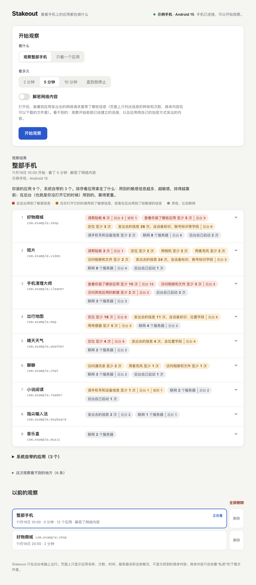
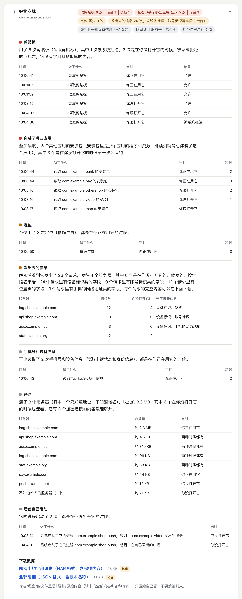

# Stakeout

Stakeout 回答一个问题：**手机上的应用都在做什么？**

它从应用外部观察一部已 root 的安卓手机：系统记录（权限使用、系统日志、进程表）、内核文件跟踪和抓包，可选解密 HTTPS 内容。它不往应用里放任何代码；应用能察觉到什么，见下面“应用能察觉到什么”。

一次观察可以看**整部手机**（同时看所有应用），也可以**只看一个应用**。看完后得到一份按“拿走了什么”排序的应用列表：每个应用几条带次数的概况，点开是明细，实际的数据可以下载。只看一个应用时，还有一份详细的中文 HTML 报告。



图里的手机、应用、服务器和数字都是编出来的，用来展示页面的样子。

<details>
<summary>点开一个应用看到的明细（同样是编出来的数据）</summary>



</details>

## 需要什么

- 一台已 root 的安卓手机，开启 USB 调试并用数据线连接电脑。在手机的 root 管理器里要允许 Shell（com.android.shell）使用超级用户：电脑上运行 `adb shell su -c id`，输出里有 `uid=0` 就可以。用 KernelSU 测试过；Magisk、APatch 这类同样提供 `su` 的方案按原理可用，没有实测。
- 一台 Mac 或 Windows 电脑，装有 Python 3.12 或更新的版本（测试在 3.12、3.14 和 3.14 的自由线程版上跑），不需要安装任何第三方包。Windows 上从 https://www.python.org 安装（不要用应用商店版）。双击启动时会自己找一个够新的 Python，见下面“先用网页”。Mac 版在真机上测过；Windows 版见下面“在 Windows 上”。
- adb。查找顺序：环境变量 `AW_ADB`，项目旁边的 `../adb-tools/platform-tools/adb`（Windows 上是 `adb.exe`），`PATH`；都没有时再找常见的位置：Android SDK 的 `platform-tools`（环境变量 `ANDROID_HOME`、`ANDROID_SDK_ROOT`，然后是 Android Studio 默认的 SDK 文件夹），解压在项目旁边、用户文件夹、“下载”或桌面里的 `platform-tools` 文件夹，Windows 上还有系统盘根目录的 `C:\platform-tools`，Mac 上还有 Homebrew 装的 adb。
- 看没加密的请求（见下面“没加密就发出去的请求”）和解密 HTTPS 内容时需要：
  - 电脑上的 Wireshark（用的是其中的 `tshark`，用 4.6.10 测试过）。没有它也能观察，只是看不到请求的内容。查找顺序：环境变量 `AW_TSHARK`；Mac 上是项目旁边的 `../wireshark-tools/Wireshark.app/Contents/MacOS/tshark`、`/Applications/Wireshark.app/Contents/MacOS/tshark`，Windows 上是项目旁边的 `../wireshark-tools/Wireshark/tshark.exe`、`C:\Program Files\Wireshark\tshark.exe`；最后是 `PATH` 里的 `tshark`。Stakeout 不安装它，请从 https://www.wireshark.org 下载。
  - 只有解密时才需要：手机用的 eCapture v2.11.0 android-arm64 程序，放在电脑上。查找顺序：环境变量 `AW_ECAPTURE`，项目旁边的 `../ecapture-tools/ecapture`。采集时 Stakeout 把它推到手机上运行，结束后删掉。

## 先用网页

双击项目文件夹里的 `Stakeout.command`（图标是一个像素侦探）：会开一个终端窗口并在浏览器里打开网页，关掉那个终端窗口就是退出。它做的事和下面这条命令一样：

```
python3 stakeout.py ui
```

图标存在文件的附加属性里，源图是 `icon.png`；用不保留附加属性的方式复制这个文件，图标会丢，文件本身照常能用。

Windows 上双击 `Stakeout.exe`（也是像素侦探图标，在发布版的压缩包里）或 `Stakeout.bat`，做的是同一件事；命令行里把 `python3` 换成 `py`。

双击启动时用的是找到的第一个 Python 3.12 或更新的版本：Mac 上依次试 `python3.14`、`python3.13`、`python3.12`、`python3`；Windows 上依次试 `py -3`、`python`、`py -3.14`、`py -3.13`、`py -3.12`。都不够新或都没有时，窗口里会说明。用更旧的 Python 在命令行里运行 `stakeout.py`，它也会说明需要哪个版本。

终端里会给出一个网址（`http://127.0.0.1:8765/?token=…`）并打开浏览器。网页只有这台电脑能打开，网址里的 token 是这次启动时生成的；关掉浏览器不会停止，在终端按 Ctrl+C 退出（正在进行的观察会先正常结束并整理好结果）。`--port` 换端口，`--no-open` 不自动打开浏览器。

在网页上：

- 顶上一行说手机的状态：没连接、没有 root、电脑上缺少解密要用的程序，都会直接说明。
- **开始观察**：选“观察整部手机”或“只看一个应用”（从手机上的应用里选），选看 2、5、10 分钟或“直到我停止”，选要不要解密，然后开始。观察期间照常使用手机。
- **观察结果**：最上面是“没加密就发出去的请求”：哪些应用用明文 HTTP 发了请求，各发了几次、几次是在你没打开它的时候，发往哪些服务器，按字段名看带了哪些信息。下面是应用列表，按拿走了什么排序，排序的意思写在列表上方。先列你装的应用，系统自带的应用折叠在下面。每一行是应用的名称和几条概况，例如“定位 至少 5 次｜后台 2”，颜色表示要不要留意；“后台”是你没打开它时的次数，“被拒”是被系统拒绝的次数。防休眠、振动、调音量这类每个应用都会用、又不涉及你的信息的权限不列在这里。点开一行，是每一类的一两句说明和明细表格，最后是下载链接。这次观察看不到的东西，折叠在列表最下面。
- **以前的观察**：这台电脑上做过的观察，点开看结果。每条旁边有“删除”，列表上方有“全部删除”：删除的是那次观察在电脑上的全部数据（抓到的内容、整理出的结果、可下载的文件），删除前会问一次，删了不能恢复。

观察的数据存在项目的 `runs/` 目录里，每次一个子目录。应用的名称是从手机上应用的安装包里读出来的，存在 `cache/labels.json`：每次观察结束后只读榜上还没有名称的应用（几秒钟）；选“只看一个应用”时，第一次要读你装的全部应用，大约一分钟。

## 命令行

```
python3 stakeout.py run --all [--seconds 300] [--decrypt]          # 观察整部手机
python3 stakeout.py run <包名> [--seconds 300] [--decrypt]          # 只看一个应用
python3 stakeout.py fetch                                          # 停止并取回手机上以前留下的采集
python3 stakeout.py analyze <运行目录> [--out 目录] [--har 文件]     # 用保存的原始数据重新分析，不需要手机
python3 stakeout.py list [关键词]                                  # 列出手机上你装的应用
python3 stakeout.py ui [--port 8765] [--no-open]                   # 网页
```

`run` 开始后照常使用手机；按回车结束（Ctrl+C 也会正常结束并清理手机上的采集程序）。用 `--seconds` 时到时间自动结束。结束后（`fetch`、`analyze` 也一样），终端里先列出没加密就发出去的请求，格式和网页最上面的一样：

- 整部手机：运行目录里写出 `overview.json`（网页上的结果）和 `apps/<包名>/` 下每个应用的下载文件。
- 一个应用：运行目录里写出 `result.json`、详细报告 `report.html`，以及 `overview.json` 和 `apps/<包名>/`。

如果采集时电脑和手机断开了（拔了数据线、电脑休眠、关了终端），手机上的采集会在设定的最长时间（按回车结束时为 60 分钟，用 `--seconds` 时为设定秒数再加 5 分钟）到达，或手机存储空间少于 1 GB 时自行停止，数据留在手机上。重新连接后运行 `fetch` 取回数据并分析。手机上还有这样一次采集时，`run` 和网页都不会开始新的采集，而是提示先运行 `fetch`。

`run` 的其他选项：`--out` 指定运行目录（默认 `./runs/<包名>-<时间>/`，整部手机是 `./runs/phone-<时间>/`；必须是新目录、空目录或以前的运行目录），`--no-net` 不抓包，`--no-filetrace` 不跟踪文件，`--serial` 在连了多台设备时指定一台。`run`、`fetch`、`analyze` 都可以加 `--show-secrets`，只影响详细报告，见下面“详细报告隐藏哪些值”。在项目目录里运行命令行时，结果也会出现在网页的“以前的观察”里。

## 在 Windows 上

1. 装 Python 3.12 或更新的版本（https://www.python.org ，安装时勾上 “Add python.exe to PATH”）。
2. 下载 Android platform-tools 的 Windows 版，把解开的 `platform-tools` 文件夹放进项目旁边的 `adb-tools` 文件夹里（得到 `adb-tools\platform-tools\adb.exe`），或者直接放在用户文件夹（`C:\Users\<用户名>\platform-tools`）、“下载”或桌面里，也可以加进 `PATH`。装了 Android Studio 的话，它自带的 adb 也能找到。手机第一次连 Windows 电脑时，可能要装手机厂商的 USB 驱动，`adb devices` 才能看到手机。
3. 下载 Stakeout：在 Releases 里下载 Windows 版的压缩包再解开（也可以用 `git clone`）。推到手机上运行的脚本必须保持 Unix 的换行方式，仓库里已经设好，不要用会改换行的编辑器去改 `aw\phone\` 里的文件。
4. 要解密的话，装 Wireshark 的 Windows 版（默认装到 `C:\Program Files\Wireshark`），eCapture 用的是和 Mac 上同一个手机程序，放到项目旁边的 `ecapture-tools\ecapture`。
5. 双击 `Stakeout.exe`（压缩包里有，图标是像素侦探）。它没有数字签名，第一次打开时 Windows 会提示“Windows 已保护你的电脑”：点“更多信息”，再点“仍要运行”。它只是用 Python 启动 Stakeout，源代码在 `launcher\Stakeout.cs`。用 `git clone` 得到的代码里没有这个程序，双击 `Stakeout.bat`，效果一样。

## 整部手机的观察：看得到什么，看不到什么

一次观察同时记录所有应用，再按应用分开：

- **权限**（定位、相机、麦克风、通讯录、短信、通话记录、日历、手机号和设备信息、相册和文件、传感器等）：每 10 秒读一次系统的权限记录。系统只记下每项权限最后一次使用的时间，两次读取之间同一项权限用了多次只能看出一次，所以次数写“至少”。
- **剪贴板**：系统日志里的剪贴板记录，加上权限记录；只算读取，被系统拒绝的单独数出来。
- **你装了哪些应用**：读取其他应用安装包的文件访问，和查询应用使用情况的权限。
- **其他应用的数据**、**相册和文件**：内核文件跟踪看到的、进入其他应用数据目录和公共文件夹的读写。
- **后台自己启动**：你没打开它的时候，它的进程被启动了，以及是谁让它启动的。
- **联网**：连了哪些服务器、收发多少（来自抓包）。
- **发出去的信息**：发了多少个请求、发往哪些服务器，以及按字段名看，带了设备标识、账号标识、位置、手机的网络地址、登录凭据中的哪几类。没加密的请求不用解密就算在里面（见下面“没加密就发出去的请求”）；加密的请求要解密才看得到。

“在后台”指你没打开它的时候：那一秒手机最前面的界面不是这个应用。排序按拿走了什么：越敏感的类别分量越重，在后台发生的算三倍。

归属到应用的办法：进程按它运行时的应用身份，文件访问按进行访问的进程，网络连接按每秒一次查看到的手机上所有连接。所以：

- 只存在不到 1 秒的连接和进程可能没被看到，这些流量不知道是哪个应用的，不算到任何应用上，在结果最下面“这次看不到的”里给出数量。系统代应用做的域名查询也是这样。
- 系统本身（不属于任何应用的系统程序）做的事不列出，只在最下面给出数量。
- 这次观察里什么都没看到的应用不列出，最下面说明有多少个。
- 一个服务器地址如果在抓包里对应好几个域名（几个公司共用的服务器），而应用自己的连接没有说出域名，这个服务器算作“不知道域名”。
- 整部手机的观察没有每个进程的 CPU 用量，也没有只看一个应用时每秒一次的权限查询。

## 没加密就发出去的请求

用明文 HTTP 发的请求没有加密，同一个网络里的其他人（例如同一个 Wi-Fi 上的人）和网络运营商都能看到、也能改动它的内容。抓包里本来就有这些内容，所以不用打开解密，每次观察都会检查：电脑上的 `tshark` 读出抓包里所有不是加密连接、开头是 HTTP 请求的 TCP 连接（不只是 80 端口），再按上面的办法对上应用。

结果在网页最上面和终端里，每个应用一行：几个请求、几个是在你没打开它的时候发的、发往哪些服务器、按字段名看带了哪些信息。应用的“发出去的信息”里标着其中几个没加密，详细报告里有单独一节“没加密的请求”，下载的 `requests.har` 里有每个请求的完整内容（网址以 `http://` 开头）。

看不到的：

- 不到 1 秒的连接对不上应用（见上面），这些请求单独写一行“不知道是哪个应用发的”，并列出发往的服务器。
- 采集开始前就已连上的连接，从抓到的第一个完整请求读起，之前的部分不算。
- 只认得出 HTTP。应用自己定义的、不是 HTTP 的没加密内容，不在其中。
- 服务器的名称来自请求里的 `Host`。`Host` 是 IP 地址时，网页上写“只知道地址的服务器”，不显示地址。
- 观察时没打开、没在后台联网的应用，不会出现。
- 电脑上没有 `tshark` 时不检查，网页和终端里会写明。

## 概览和下载

网页上只显示应用名称和包名、次数、时间、权限和类别的名称、服务器的域名、文件夹名称，以及字段的名称（从不显示字段的值）。服务器域名里像编号的一段（32 个以上同时含字母和数字的字符）换成“〈编号〉”。请求头和查询参数的值、正文、令牌、手机的 IP 地址、公共文件夹里的文件名都不在网页上，所以网页可以给别人看。

实际的数据在下载文件里，网页上标为“私密”。它们含有你的账号、设备和个人信息，不要随手发给别人：

- `requests.har`：这个应用的全部请求和响应（解密出的和没加密的），含完整的头部、查询参数和文本正文，HAR 1.2 格式，可以用浏览器的开发者工具或代理工具打开。不是文字的正文没有保存内容，只在每条记录的 `_stakeout` 说明里给出大小、sha256 和开头的字节。
- `detail.json`：概况背后的每一行明细，不截断，带技术名称（权限的代号、进程号、网络地址、文件路径等）。
- `report.html`：只看一个应用时的详细报告（默认隐藏的值见下面）。

## 解密 HTTPS 内容

**密钥解密（`run --decrypt`，或网页上打开“解密网络内容”）**：采集期间，手机上的 eCapture 在应用通过系统 TLS 库（`/apex/com.android.conscrypt/lib64/libssl.so`）建立加密连接时，记下这次连接的密钥（运行目录的 `tls_keys.log`）；采集结束后，电脑上的 `tshark` 用这些密钥解开抓到的数据包（`net.pcap`），Stakeout 再从中读出每个请求和响应。每条 TCP 连接单独解开，请求和响应在同一条连接里，不需要推测谁和谁对应；没有密钥的连接保持加密，算作没有解开，不做猜测。不需要安装证书，也不改手机设置。观察整部手机时记下的是所有应用的密钥，解开的连接也要按上面的办法对上应用，对不上的不算到任何应用上。

找不到 `tshark` 或 eCapture 时，`run --decrypt` 在连接手机之前就说明，网页上的解密开关不能打开；`analyze` 时找不到 `tshark` 或运行出错，照常分析，局限里写明没能解密。

它解不开的：

- 采集开始前就已建立的连接：抓包里没有建立连接时的握手，也就没有密钥。所以解密时，开始采集以后，把你关心的应用彻底停止（系统设置的应用信息里点“强行停止”）再重新打开。只看一个应用时，开始采集时应用已经在运行，`run` 会提醒。Stakeout 自己不停止也不启动应用。
- 应用用自带的加密库（例如小红书的 Cronet）建立的连接：eCapture 只记录系统 TLS 库的密钥。
- QUIC（HTTP/3，走 UDP）连接。
- tcpdump 没有抓到的数据包（手机繁忙时可能丢包）里的内容。

只看一个应用时，详细报告按连接说明解密覆盖了多少：应用的加密连接中，几个解开了，几个在采集开始前就已建立，几个是采集期间建立但没有记录到密钥，几个有密钥但没有解出内容（例如握手后没有收发数据就关闭了），各自连到了哪些服务器。密钥只记录这个应用的，所以解开的连接都是它的；没有解开的连接，只算轮询时看到属于这个应用的（每 1–2 秒查看一次，很快就结束的连接可能没有算进去）。

较早版本的 `run --decrypt` 用 eCapture 直接记录系统 TLS 库里的明文（运行目录的 `tls_events.log`）。`analyze` 仍然读取这样的运行目录；运行目录里同时有 `tls_keys.log` 时只用密钥解密。那种记录没有连接标识，采集开始前已建立的 HTTP/2 连接上的请求常常缺少域名和部分请求头，报告里每个这样的请求都注明了。

**代理录制的 HAR 文件（`analyze <运行目录> --har 文件`，只用于只看一个应用的采集）**：应用不用系统 TLS 库时，可以用这个办法。你自己在电脑上开一个中间人代理（例如 mitmproxy），把代理的证书装进手机的系统证书，把手机的代理设到电脑上，用应用，然后把录到的内容导出成 HAR 文件。步骤和怎么还原设置见 [docs/MITM.md](docs/MITM.md)。Stakeout 不做其中任何一步，只读取 HAR 文件：它被复制到运行目录的 `mitm.har`，以后不带 `--har` 重新分析也会用上。代理录到的是整部手机经过代理的请求，可能有其他应用的，所以概览不把它们算作这个应用的；不在采集时间内的请求在报告里单独标出。校验证书（证书固定）的应用和不是 HTTP 的协议，这个办法也看不到。

## 详细报告隐藏哪些值

这一节说的是只看一个应用时的 `report.html`。`result.json` 和下载的 `requests.har` 里保存完整的值。报告默认把下面这些值换成“〈已隐藏，N 个字符〉”，名称照常显示：

- 名称表示登录凭据、签名、设备或账号标识、客户端 IP 地址的值，例如 `Cookie`、`Set-Cookie`、`Authorization`、`Proxy-Authorization`、`x-auth-token`、`web_session`、`sid`、`sign`、`deviceId`、`uid`、`xhs-real-ip`（完整的名单在 `aw/exchange.py`）。不论这样的“名称=值”或 `"名称": 值` 出现在哪里都隐藏：请求头和响应头、查询参数、网址 `#` 后面的部分、路径里的 `;名称=值`、请求头的值里用 `&`、`;`、`,`、空格或换行隔开的字段、表单正文（包括按表单发送的 JSON）、文本正文（包括 multipart 表单的字段和 HTML 的属性）、任意一层的 JSON，以及 JSON 字符串里的网址和 `名称=值`。值加了引号、`=` 两边有空格，或者经过编码（网址里的 `%2F`、HTML 里的 `&quot;`、JSON 里的 `=`），都先还原再判断。JSON 里这样的值是数组或对象时，整个隐藏。`Cookie`、`Authorization` 这样整个隐藏的头部，里面的每个值也算隐藏了的值（见第三条）。
- 不论名称是什么（或者没有名称），看起来像令牌或编号的值：JWT，或 32 个以上同时含字母和数字的 base64、十六进制字符。正文、头部的值和 JSON 字符串里这样的词，在句子中间或跟在 `Bearer` 后面也隐藏。
- 上面隐藏的值只要有 8 个以上字符，它在“解密内容”这一节其他任何地方出现时也换掉，例如出现在更长的路径、查询参数、请求头或正文里，换了写法（例如 `/` 写成 `%2F`）也一样。报告其他各节（例如开头的包名、网络一节的服务器地址）不受这一条影响。
- 二进制正文只显示类型和大小，sha256 和开头字节的十六进制不显示。

正文没有记录完整时（只记录到一部分，或超过 64 KB 被截断），末尾没记完的那个值看不出是不是令牌，所以不显示，原处写着“〈没有记录完整，不显示，N 个字符〉”。每个正文只显示开头 4,096 字节，默认的报告和加 `--show-secrets` 的报告显示的是同一段。除了隐藏的值，两份报告的内容相同，经过编码的值也都按传输时的写法显示。

不隐藏的有：名称、域名、路径的其余部分、方法、状态码、大小、时间、`access-control-*` 头部的值，以及不是上面这些形式的文字。程序不检查这些文字：名称不在名单里、又不到 32 个字符的令牌，名称不在名单里的手机号、昵称、位置，User-Agent 和报告开头里的手机型号，都会照原样显示。所以默认的报告里仍可能有你的账号、设备和个人信息，转给别人之前要自己从头看一遍。加 `--show-secrets` 时报告显示原值，这样的报告不要发给别人。

br、zstd 压缩的正文无法用 Python 标准库解码，报告只给出大小（加 `--show-secrets` 时还有 sha256 和开头字节的十六进制）。头部里的压缩方式（Content-Encoding）没能还原时（只发生在较早版本的 `tls_events.log` 里），正文只有是完整、校验和正确的 gzip 数据才解压；其他不是文本的正文标为没有解码，同样只给出类型和大小（加 `--show-secrets` 时还有 sha256 和传输时原样的开头字节）。

## 应用能察觉到什么

基本的观察（系统记录、文件跟踪、抓包）应用察觉不到，解密的两个办法则可能被察觉。eCapture 记录密钥时不往应用里放代码，但会在系统 TLS 库上留下内核探针（uprobe），应用如果去查就能发现：它内存里这个库的函数入口处变成了断点指令，进程的内存映射里多了一项 `[uprobes]`。代理路线最容易被发现：系统证书库里多了一个证书，手机设了代理。某个应用会不会去查这些，不知道。

## 详细报告里有什么

只看一个应用时的 `report.html`：

- **要点**：几句带数字的结论，需要留意的排在前面。
- **权限使用**：用了哪些权限、被拒绝了哪些、最后一次的时间、当时是否在前台。
- **剪贴板**：读取和写入的次数，哪些被系统拒绝。
- **文件访问**：应用自己的数据、其他应用的安装包和数据目录、共享存储（照片、下载等）、系统文件。
- **进程与唤醒**：应用的各个进程、系统因为什么启动它们、应用自己通过 `app_process` 启动的进程、应用身份下运行的其他命令（如 `ping`）。
- **网络**：连接的远程地址和域名，收发字节数（约数）。
- **没加密的请求**：它用明文 HTTP 发出去的请求，按域名汇总，然后是每个请求的头部和正文（隐藏的值和“解密内容”一样，见下面）。
- **解密内容**：解密覆盖了应用的哪些连接、没有解开的原因和服务器，按域名汇总的请求数，然后按域名分组列出每个请求的头部和正文。超过 300 个请求时，每个域名先完整列出一部分，其余的只列一行摘要，完整内容在 `result.json` 里。
- **时间线**：前台切换、进程、权限、剪贴板、文件、网络事件和解密到的请求按时间合在一起。
- **采集说明与局限**：这次缺了哪些数据，对结论有什么影响。

## 局限

- 不解密也不导入 HAR 文件时，加密连接只看到域名和流量大小，看不到内容；没加密的请求照样看得到。解密能看到哪些内容，见上面“解密 HTTPS 内容”。
- 前台状态、进程和网络连接是大约每秒查看一次得到的（只看一个应用时每 1–2 秒，权限也是）：两秒内开始又结束的事可能看不到，由查看推算的时间可能相差几秒。只看一个应用时，发生在前台切换前后的事，报告不判断当时应用是否在前台。
- 系统的权限记录只保留每种状态下的最后一次，所以有些权限只能说“至少发生过一次，最后一次在某时”。
- 只看一个应用时抓包也是全系统的。只有查看时看到应用自己的连接，才能确定哪些流量属于这个应用；否则报告只列出全系统的域名。
- 文件跟踪只覆盖 `/data` 分区（f2fs），只记录得到真正读写手机存储的那些：系统已经放在内存里的内容再读一次看不到，所以写“至少”。文件访问的时间是换算出来的，可能比实际早 1 秒左右。前台切换前后这段时间里的文件访问，不判断当时应用是否在前台。
- 手机上没有 tcpdump，或内核没有 f2fs 跟踪事件、不接受跟踪的过滤条件时，开始采集时会说明，结果里也会写明，这部分数据就没有。
- 文件访问按进程号归到应用。只看一个应用时，没有找到应用的任何进程号，报告不下“没有访问”的结论，只在局限里说明。

## 关于这个仓库

- 仓库里的测试（`tests/`）是不依赖真实抓包数据的那一部分，运行：`python3 -m unittest discover -s tests`。用真实手机数据回放的测试和那些数据本身含有私人信息，没有放进仓库。
- 代码注释里提到的 `docs/CONTRACT*.md` 是开发时的内部设计文档，同样没有放进仓库。
- 观察得到的数据（`runs/`）和应用名称缓存（`cache/`）只留在你自己的电脑上，已在 `.gitignore` 里排除。
